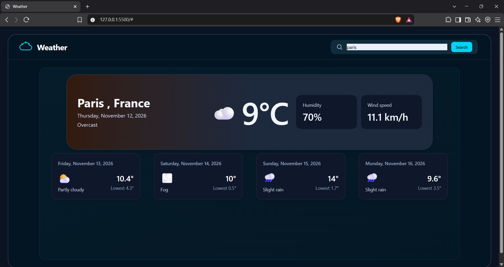
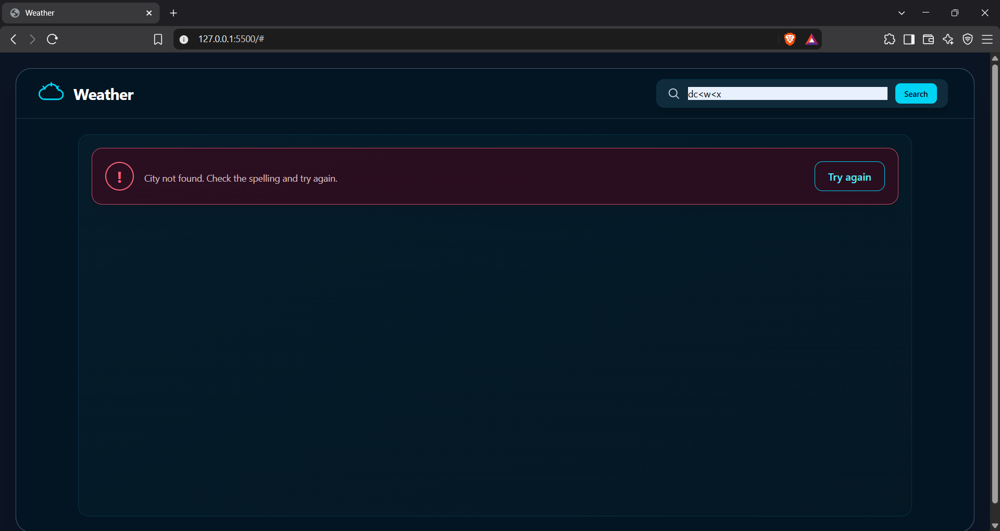

# Multi-City Weather Application

A browser-based weather app that lets you search for a city and view its current weather and a four-day forecast. It uses the Open-Meteo Geocoding and Forecast APIs, with no API key required.

## Features

- Search for a city by name.
- View the current temperature, condition, humidity, and wind speed.
- View the next four days of high and low temperatures and weather conditions.
- See an error message for an empty search, an unknown city, or an unavailable API.
- Retry a failed request from the error message.

## APIs used

### 1. Geocoding API

Resolves the search text to the first matching place and its coordinates.

```text
GET https://geocoding-api.open-meteo.com/v1/search
```

Parameters used:

| Parameter | Value or purpose |
| --- | --- |
| `name` | City name entered by the user, URL-encoded |
| `count` | `1` (use the first result) |
| `language` | `en` |
| `format` | `json` |

The app reads the result's `latitude`, `longitude`, `name`, and `country` fields.

### 2. Forecast API: current conditions

Uses the coordinates from geocoding to request current conditions.

```text
GET https://api.open-meteo.com/v1/forecast
```

Parameters used:

| Parameter | Purpose |
| --- | --- |
| `latitude`, `longitude` | Coordinates returned by geocoding |
| `current` | `temperature_2m,relative_humidity_2m,weather_code,wind_speed_10m,is_day` |
| `timezone` | `auto`, to use the location's local time |

The app displays the current time/date, temperature, humidity, wind speed, and a condition label/icon mapped from `weather_code`. The `is_day` value is requested but not currently used in the display.

### 3. Forecast API: daily forecast

```text
GET https://api.open-meteo.com/v1/forecast
```

Parameters used:

| Parameter | Purpose |
| --- | --- |
| `latitude`, `longitude` | Coordinates returned by geocoding |
| `daily` | `weather_code,temperature_2m_max,temperature_2m_min` |

The app displays entries at daily array indexes 1 through 4: the next four days, with each day's date, condition, maximum, and minimum temperature.

## Example of the app's summary data

The API returns separate geocoding and forecast responses. 

```json
{
  "city": "London",
  "country": "United Kingdom",
  "time": "2026-11-12T12:00",
  "temperature": 12.4,
  "humidity": 76,
  "weather_code": 3,
  "wind_speed": 14.8
}
```

Values above are illustrative; actual values depend on the city and time of the request. The app uses `weather_code` to look up a human-readable condition and icon in `data.js`.

For each forecast day, it uses a summary like:

```json
{
  "time": "2026-11-13",
  "maxtemp": 14.1,
  "mintemp": 8.2,
  "weather_code": 61
}
```

## Manual test log

| Check | Steps | Expected result | Status / notes |
| --- | --- | --- | --- |
| Valid city | Searched for `London` | Current conditions and the next four forecast days appear | Passed — current weather and four forecast cards appeared |
| Different city | Searched for `Paris` after London | The displayed city and weather update | Passed — results updated to Paris, France |
| Empty search | Submitted with the input blank | A clear validation message appears | Passed — “Please enter a city name.” appeared |
| Unknown city | Searched for `zzqvnotacity987` | A city-not-found message appears | Passed — “City not found” appeared |
| Retry | Selected **Try again** on the unknown-city error | The app repeats the search | Passed — the city lookup ran again and showed the expected error |
| Network/API error | Network outage or blocked API request | An error message appears and loading ends | Passed |
| Responsive layout | Checked a narrow browser window and existing desktop screenshot | Search and weather cards remain usable | Passed |


## Limitations and error handling

- The app depends on the public Open-Meteo services and an internet connection. If either service is unavailable, the search may fail.
- The public APIs are subject to their usage policies and request limits. The app does not configure a paid plan or an API key. It displays an error when a request is rate-limited (`HTTP 429`), but it does not automatically retry or cache results.
- Geocoding uses only the first matching result, so ambiguous city names may resolve to a different place than intended.
- The app requests metric weather fields and displays temperatures in Celsius and wind speed in km/h.
- Only the weather codes listed in `data.js` have labels and icons. Unexpected codes may not render correctly.
- Tailwind CSS is loaded from jsDelivr, so the page also needs access to that CDN for its styling.

## Screenshots

### Main weather view



### Error state



## Project files

- `index.html` — page structure and styling classes.
- `script.js` — city search, API requests, rendering, and error handling.
- `data.js` — weather-code labels and icons.
